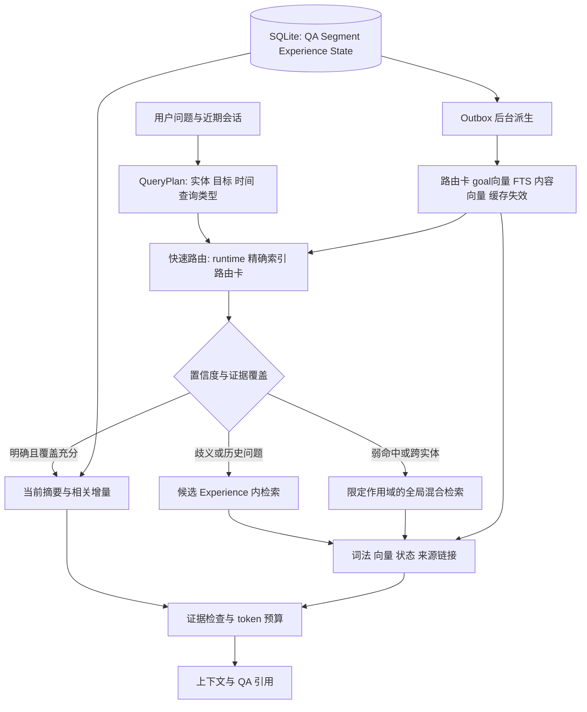

# HESM 记忆管理改进设计：路由准确性与检索延迟

日期：2026-09-19。状态：设计提案，尚未实现或验证性能收益。

检查对象是 `D:/code/hesm` 当前工作区，HEAD 为 `96cf03f657ea6131d470a248240bc09cfc18a5a4`，包含工作区已有修改。本文以实际代码为准，不把旧实验计划中的历史问题当作当前缺陷。此轮只新增设计文档。

## 1. 设计结论与不变量

保留 **Experience → Segment → QA、State 增量归并、completed Experience 经验复用** 三项核心理念。新增可重建的检索索引和分级查询计划，让三层结构负责组织与解释，让检索入口根据问题选择层级和范围。

核心变化：**由“先选定唯一 Experience，未命中才做 QA 回退”，演进为“高置信度快速定位，歧义时保留多个候选，证据不足时扩展检索”。**

必须保持：

1. QA 是原始证据；摘要中的事实、状态和经验可以回溯到来源。助手回答属于对话记录，不自动视为用户确认的事实。
2. Experience 保持长期主题/实体/目标组织，Segment 保持阶段与意图组织，不将主结构改为平铺向量库。
3. 保留稳定的 `experience_route` 身份向量与可变 `experience` 内容向量分离；goal 等变化内容使用独立派生表示。
4. 保留“父级摘要＋尚未归并的子级增量”；摘要水位表示覆盖范围，不表示旧证据禁止被检索。
5. 查询不新建 Experience、不推进摘要水位、不改变业务状态；统计和缓存另存。
6. SQLite 是权威存储，Chroma、FTS、路由卡和缓存都是可重建派生数据。
7. 经验迁移默认使用 completed Experience，继续通过现有 outbox 在后台执行。
8. 初期沿用现有物理库隔离；`state_key` 是会话指针，不能被当成用户权限边界。

## 2. 当前实现与可验证的问题

| 当前行为 | 代码证据 | 改进方向 |
|---|---|---|
| 检索已经只读；已使用摘要更新边界 | `core/retriever.py::retriever`、`ReadOnlyHybridRetriever` | 保留，不重复设计“只读改造” |
| runtime 或 SQLite 的 topic/entity 命中直接返回，confidence 固定为 1.0 | `core/retriever.py::_route_existing` | 区分身份匹配与答案相关性，加入目标、时间和任务实例检查 |
| 多组 query_candidates 按序尝试，首次命中就停止 | `core/retriever.py::retriever` | 多实体/比较问题保留联合候选，不能用首个命中代表整个问题 |
| 路由向量只取 top 5，再从 SQLite 排除非 open 记录 | `_experience_vector_candidates`、`manager.py::_find_experience_by_vector` | 有界补召回；解决 completed 记录占据候选窗口的问题 |
| 路由向量创建时写入 open 状态，后续不刷新该身份向量 | `manager.py::create_experience_route_vector`、`worker.py` | 不能只加 `status=open` 过滤就声称修复；需同步可变 metadata 或维护 active membership |
| top 2 相近时计算 query 和两个 goal 的向量，无 goal 时按更新时间选择 | `manager.py::_select_ambiguous_by_goal` | goal 在后台编码；无法消歧时保留候选，不把“最近”当语义证据 |
| 正常路径返回 Experience 摘要、未归并 Segment，以及最新 Segment 的未归并 QA | `core/retriever.py::retriever` | 增加跨增量 Segment 的证据覆盖，并允许定向读取已经归并的 QA |
| QA 回退已有 dense、父摘要来源扩展和 RRF | `core/retriever.py::_qa_fallback` | 复用现有能力，补充正文词法检索、计划控制和候选上限 |
| SQLite 关键词路径只查 topic/entity/intent 与 JSON 实体成员 | `core/storage.py::search_qas` | 增加正文 FTS 与实体倒排表，保留结构化精确通道 |
| 服务每次查询先调用主题抽取；服务锁覆盖抽取、检索，聊天还覆盖生成和写入 | `service/hesm_service.py::retrieve`、`_chat_events_impl` | 确定性查询预处理、按需抽取、读连接隔离、缩短临界区 |
| retrieve 传 query_candidates，而聊天检索调用没有传入 | 同上 | 统一 QueryPlan 构造，避免两个入口表现不一致 |
| embedding 客户端逐次发送请求，没有该层的结果缓存 | `core/embedder.py::BailianEmbedder.embed` | 模型版本隔离的缓存与批处理 |

本地只读检查发现当前主库只有 4 个 Experience、4 个 Segment、4 条 QA，不能用它推导规模性能。对 `search_qas` 的代表性 `OR + json_each + ORDER BY` 查询形状执行 `EXPLAIN QUERY PLAN`，出现 `SCAN q`、关联子查询与临时排序树。它说明存在扫描路径，不是大规模延迟的测量结果，也不代表所有查询条件都使用同一执行计划。

## 3. 外部方案的借鉴边界

以下依据访问当日官方资料；OpenClaw 变化较快，实施时记录所对照的版本或 commit。

| 方案 | 已核实机制 | 在 HESM 中的对应设计 |
|---|---|---|
| OpenClaw | 可读记忆文件、显式检索工具、压缩前持久化和后台整理 | 保留 QA 可追溯性；提供 search/get 与可读导出；会话结束/压缩前确保原始记录落库，父摘要继续异步。见 [Memory](https://docs.openclaw.ai/concepts/memory) |
| OpenClaw Search | 向量与 BM25 混合检索、确定性排序、MMR 去冗余 | 正文词法通道与向量通道互补；用已有 RRF 融合；写入阶段生成重要性等附加特征。见 [Memory search](https://docs.openclaw.ai/concepts/memory-search) |
| OpenClaw Builtin | SQLite 派生索引、增量索引与检索降级 | 增量索引 outbox、可观测索引水位、语义路径超时时返回可用词法证据。见 [Builtin engine](https://docs.openclaw.ai/concepts/memory-builtin) |
| Letta | 持久化完整状态，少量核心记忆驻留上下文，旧消息可再次检索 | 由当前 Experience/Segment 派生有限的 working set，不把整个历史常驻 prompt。见 [Stateful agents](https://docs.letta.com/v1-sdk/concepts/stateful-agents) |
| Mem0 | 从交互提取事实，使用用户/会话标识和 metadata 限定检索范围 | 规范实体与事实字段；保留各自来源和有效范围。本文不假定不同版本都自动覆盖冲突记忆。见 [Add memory](https://docs.mem0.ai/core-concepts/memory-operations/add) |
| Graphiti / Zep | 时间关系、事实失效与历史上下文，语义＋BM25＋RRF 等检索 | 在现有 State 上补充事实有效期与来源链接，按需做一跳扩展。见 [Overview](https://help.getzep.com/graphiti/getting-started/overview)、[Searching](https://help.getzep.com/graphiti/working-with-data/searching) |

HESM 仍采用 SQLite＋Chroma。Markdown 可以作为导出和审阅视图，不新增第二套可编辑权威存储。完整图数据库、每次查询多轮 LLM 推理均不作为第一阶段依赖。

## 4. 总体架构



读路径与写路径共享实体归一化和候选评分，但使用不同决策策略：**读取可以联合多个 Experience，写入必须确定唯一归属或建立可追踪的新分支。**

## 5. 路由准确性设计

### 5.1 QueryPlan 与实体规范化

建议字段：

```text
scope_id / state_key / session_revision
raw_query / normalized_query
query_type: continuation | fact | history | comparison | procedure
entity_candidates: [(canonical_id, alias, confidence, provenance)]
topic_candidates / intent_candidates / goal_hint
time_range / temporal_mode: current | as_of | history
needs_multi_experience / extraction_confidence
deadline / candidate_budget / token_budget
```

先用本地规则识别明确 ID、项目名、时间表达和实体别名；短追问可从近期会话获得候选，但不能无条件沿用上次实体。无法解析的指代、同名实体或多个潜在主题再触发现有抽取器。规则输出和 LLM 输出使用同一结构；低质量抽取不能阻断原始问题的词法/向量检索。

别名表至少包含 `scope_id, entity_id, entity_type, alias_norm, provenance, confidence`。别名可一对多，不能把“苹果”强制映射到唯一对象。自动提议的别名不立刻成为强身份约束；明确 ID 或经过验证的映射才允许硬过滤。

### 5.2 Experience 路由卡

每个 Experience 派生一张有长度上限的路由卡：

| 字段 | 用途 |
|---|---|
| topic_norm、core_entity_id、aliases | 稳定身份入口 |
| goal、goal_embedding_ref | 区分同主题、同实体的不同任务 |
| active_intents、关键实体 ID | 当前阶段相关性 |
| business_status、时间范围 | 决定是否适合续写或历史读取 |
| selected_fact_keys、source_qa_ids | 快速判断能否回答某类问题 |
| source_version、summary_version、index_revision | 检测陈旧派生内容 |

身份向量仍用 topic＋core_entity；goal 在摘要变化时通过 outbox 单独编码。新 Experience 没有摘要时，可以将初始请求提取的目标标记为 provisional，不能伪装成已确认总结。

禁止查询时重新编码数据库中已有的候选 goal。新增 `embed_many` 与查询级去重；同一请求的 identity 文本与 evidence 文本可以不同，不能为了“只调用一次”错误复用两个不等价的表示。可在一个批请求中编码需要的两个查询表示。

### 5.3 候选评分与置信度

候选来源：runtime、实体/主题精确索引、稳定身份向量、内容/goal 表示。先做作用域和删除状态过滤，再计算：

```text
route_score = calibrated_model(
    exact_entity, alias_confidence, topic_match,
    identity_similarity, goal_similarity, intent_match,
    temporal_compatibility, session_continuity,
    task_instance_compatibility, index_freshness
)
```

初版使用可解释的规则和权重，但输出称为 `route_score`；有标注数据后用逻辑回归或校准方法输出概率。余弦相似度和 top1-top2 分差不直接等同于正确率。读取阈值、写入阈值、不同查询类型分别标定，保留低置信度拒绝选择能力。

| 场景 | 读取策略 | 写入策略 |
|---|---|---|
| 实体、任务目标明确且无冲突 | 单 Experience 快路径 | 复用唯一 Experience |
| top1/top2 接近、同一实体多个目标 | 最多保留 3 个候选，再看证据 | 必须消歧；可触发一次受限判别 |
| 明确历史时间或 completed 任务 | 检索 completed 与历史 State | 不自动续写 completed 任务 |
| 低分、无可靠实体 | 作用域内全局混合检索 | 保留原文，建立 provisional 分支或待归属记录 |
| 比较或多实体问题 | 对各实体分别保留证据槽位 | 按抽取的独立记忆单元分别路由 |

provisional 分支必须有后续合并/确认任务、来源和幂等 ID，防止长期积累碎片。不能因为是新实体就等待用户确认，也不能因为有一个高余弦分数就把 QA 写入既有任务。

### 5.4 状态过滤的具体处理

现有 `experience_route` metadata 的 open 是创建快照。第一阶段使用逐步扩大 top_k 的有界补召回并在 SQLite 校验状态；例如 5 → 15 → 30，达到预算就停止。后台增加状态 metadata 更新任务，保持向量值不变，或建立单独 active-ID 集合。

完成 metadata 回填和一致性验证后，才能在向量查询中可靠地下推状态过滤。读取历史记忆允许 completed；写入复用仅允许符合业务策略的 open。任何索引命中最终都回查 SQLite。

## 6. 检索流程：按问题选择路径

### 6.1 三条路径

| 路径 | 触发条件 | 处理 |
|---|---|---|
| Fast | 高置信度续问，已知事实键或相关增量足以覆盖 | 当前 Experience 摘要＋相关 Segment 状态＋来源 QA |
| Focused | 实体/Experience 明确，但需要旧细节或存在有限歧义 | 在最多 3 个 Experience 内检索 Segment/QA，回溯摘要来源 |
| Global | 候选不足、跨 Experience、跨实体或时间比较 | 同一合法作用域内进行全文＋向量检索，再重建父层级 |

Fast 的“覆盖充分”不是非空或分数高：必须满足查询中明确的实体、时间、事实字段或子问题。初版只让短续问、明确状态字段等可验证场景进入 Fast；一般语义问句走 Focused。历史/比较问题不能因为 runtime 命中而提前结束。

Focused 无合格证据或缺少子问题时，最多向 Global 扩展一次，禁止无限回退。全局救援不限于路由候选 Experience，否则仍然无法修复首次路由错误。

### 6.2 保留增量语义，同时允许旧证据被找回

```text
Context = relevant parent summary
        + relevant unsummarized deltas from all selected segments
        + targeted historical QA evidence
```

`last_updated_segment_id`、`last_updated_qa_id` 和现有 revision 水位继续服务于归并。它们不充当搜索权限或时间过滤。历史证据按问题和来源链接读取，避免每次把所有已归并 QA 再次注入。

未归并内容超出上下文预算时，先按问题相关性选择，再保留最新状态；返回 `context_truncated` 与省略数量，不能仅为缩短 prompt 推进归并水位。摘要尚未覆盖、但本次未选中的 QA 仍在存储中可检索。

### 6.3 真正的混合候选召回

1. **结构化精确通道**：实体 ID、明确任务 ID、时间条件与状态键。
2. **全文通道**：FTS5/BM25 检索 `user_input`、`assistant_output` 及派生摘要；按字段区分来源。
3. **向量通道**：QA 与相关层级的内容语义；只有计划要求时才查询父级索引。
4. **来源通道**：从相关 summary fact/state 的 `source_qa_ids` 取证据，逐事实筛选并限制数量。

已有 RRF 可继续用：`score(d) = Σ w_channel / (60 + rank_channel(d))`。同一通道多个 query variant 合并去重后再排名，避免重复变体获得重复投票；BM25 分数和余弦分数不直接相加。确定性实体、时间与状态约束单独处理。

在不破坏独立操作的前提下并行执行词法召回和查询编码；编码后执行需要的向量分支。并行数受限，SQLite 读任务各用自己的连接。候选评分采用批量取父对象，避免逐条数据库查询。

中文 FTS 需显式选择策略：优先评测应用侧中文分词或 bigram，并保留英文词、代码符号与数字；若选择 trigram，必须补足两字中文实体和短 ID 的精确倒排通道。不能假设默认 tokenizer 已能处理中文召回。查询词参数化并转义 FTS 语法。

### 6.4 重排、去重与时间语义

先执行实体/时间/状态约束，再做 RRF 和轻量特征排序；同 QA、相同来源、重复事实合并。初期对有界候选做本地 MMR，比较问题为每个实体/子问题预留证据槽位，不能用去重删掉另一侧事实。

MMR 负责减少冗余，不等于语义精排。只有歧义样本证明有收益时，才增加本地或远程 reranker，限定候选数与截止时间。

时间规则：当前状态优先有效的新事实；“去年/当时/变更前”按指定有效区间选择；稳定偏好和规则不统一指数衰减。近期权重和重要性只在相关证据之间排序，不能覆盖实体冲突或时间约束。

### 6.5 search / get 两阶段接口

新增候选搜索与按 ID 读取接口，复用同一个 QueryPlan：

```text
search(query, scope, budget) -> ranked IDs + compact snippets + provenance
get(ids, scope, fields, token_budget) -> bounded source evidence
retrieve(...) -> 内部组合 search/get，兼容现有 service API
```

两个接口都执行作用域与删除校验；使用指定读版本或检测 search/get 之间的数据变化。响应补充 `plan_type, route_candidates, route_score, fallback_reason, partial, index_revision, context_tokens, evidence_ids, timings`。

## 7. 数据与索引设计

第一阶段增加以下派生结构，不拆换三个主表：

| 结构 | 关键字段/索引 | 更新策略 |
|---|---|---|
| `entity_alias` | scope、alias_norm、entity_id、type | 从明确实体及已验证别名增量构建 |
| `memory_entity` | scope、entity_id、memory_type、memory_id、role | B-tree 倒排，避免全表 json_each |
| `experience_route_card` | experience_id、goal、source_version、status、active_intents | outbox 更新，有长度上限 |
| `memory_search_fts_v2` | memory_type、memory_id、分字段搜索文本 | QA 插入时同步更新正文索引；父摘要异步更新 |
| `embedding_cache` | provider、model revision、dimension、input_type、document_version、content_hash | 有界缓存；不跨模型/输入类型复用 |
| `index_state` | index_name、source_revision、indexed_revision、error | 记录积压、重建和发布状态 |

FTS 是新增 v2 索引，不直接恢复旧 `qa_memory_fts`：当前初始化显式删除旧索引，测试也约束这一行为。迁移应使用新名称和显式 schema 版本，并调整测试表达的产品约定。

建议补充复合索引：Experience 的规范化 topic/entity/status；Segment 的 experience/status/更新时间；QA 的 segment/status/时间。具体列序依据真实谓词与 `EXPLAIN QUERY PLAN` 决定，不预设所有查询都获益。

State 的第二阶段扩展是现有 summary 的可追溯投影：

```text
fact_id, entity_id, predicate, value
valid_from, valid_to               # 业务有效时间，未知可为空
observed_at, superseded_at         # 系统观察与替代时间
source_qa_ids, source_role, confidence
experience_id, segment_id, source_version
```

不得用数据库更新时间伪造业务发生时间。冲突事实保留各自来源；明确“已修改为”的陈述才能建立替代关系；未知或冲突状态返回证据不足。该投影服务精确检索与时间比较，不发展成独立的无来源记忆层。

## 8. 延迟优化与一致性

### 8.1 优化顺序

1. 补充分阶段计时与锁等待计时，先区分抽取、embedding、搜索和排队。
2. 将 goal 编码移到写入/摘要后台；增加查询 embedding 缓存与批处理。
3. 增加索引化实体查询和正文 FTS；词法搜索可在 embedding 等待期间执行。
4. 统一查询入口与多候选传播，减少无效路由和重复回退。
5. 限定每阶段候选、token、分支数和总 deadline。
6. 对经过验证的简单查询跳过 LLM 抽取；歧义查询继续使用抽取器。
7. 缩短请求锁，逐步增加跨会话并发。

延迟模型为 `T = queue + plan + max(lexical, embedding + vector) + merge + evidence + pack`。这里只描述可并行部分；依赖查询抽取的分支仍需等待。embedding 缓存不保证端到端低延迟，远程抽取和锁等待仍可能占主导。

### 8.2 并发边界

当前 worker 已有独立 SQLite 连接和锁，应保留。请求侧增加按请求/线程的只读连接，网络调用不持有全局服务锁。短事务负责写 QA、关系和 outbox；同一会话仍保持轮次顺序，跨会话读和生成可以并行。

不能仅删除 `RLock`：`manager.trace_turn_ids` 等请求可变状态应改为显式请求参数或请求上下文；抽取器/客户端的线程安全、session revision、runtime 指针更新都需要同步改造。跨线程共享现有 SQLite connection 不是实现方案。

### 8.3 读写与索引水位

保留当前 QA 向量同步写入作为第一阶段基线。先完成 QA＋关系＋FTS 的原子提交，以及向量失败补偿/重试设计，再单独评测 QA 向量异步化。

若以后启用异步 QA 向量：SQLite 提交成功即可词法检索；向量进度通过 `indexed_revision` 报告；用有界近期增量集合弥补向量滞后。不能宣称异步后仍然立刻拥有完整语义召回。所有索引结果回查权威行及版本，防止删除或替代之后被旧向量命中。

派生任务使用版本条件提交与合并重试，不允许旧摘要覆盖新状态。索引重建使用替代索引并切换发布版本，失败仍使用旧索引。写入、删除、替代、摘要更新、索引发布都会使相关缓存失效。

### 8.4 缓存键与降级

query embedding 的缓存键包含模型、版本、维度、query/document 类型、模板版本和文本哈希；QueryPlan/结果缓存另包含 scope、session revision、时间查询锚点、配置哈希、业务 revision 与索引 revision。动态问题不能只按问题文本命中缓存。

缓存有容量/TTL 上限和并发请求合并。模型/分词/路由模板变化触发版本切换。第一阶段可以只缓存 embedding 与路由卡，结果缓存后置，减少一致性复杂度。

语义检索超时返回已就绪且通过门槛的词法证据，并标记 `partial` 与缺失通道；无可信证据则返回空结果。超时不同于“库中不存在”。网络重试受总 deadline 约束，记录实际降级后端，禁止将线性扫描 fallback 的数据计作正常 ANN 性能。

## 9. 记忆生命周期

继续采用“QA 原文写入 → Segment 摘要 → Experience 状态/经验 → completed 后复用”的路径。摘要阈值保持当前机制，后续可加入 token 数、时间间隔和显式任务边界触发，但必须独立消融。

主题切换与业务完成分开判断。切换时可以封闭一个阶段，但不能仅因暂时讨论其他主题就认定长期任务完成；明确完成、业务规则或经验证的状态才推动 Experience 终态。历史查询不改变这些状态。

后台整理处理重复事实、别名建议、过期索引和经验合并。合并记录保存来源和替代链接，重要性或访问频率仅辅助压缩和排序，不自动永久删除低频原始证据。用户显式删除需覆盖原始记录、派生索引和缓存。

## 10. 参数起点与验收

以下数字是实验起点和优化目标，不是已有性能或经过调优的默认值。

| 参数 | 起点 |
|---|---|
| 读取 Experience 候选 | 普通查询 1，歧义/跨实体最多 3 |
| 词法/向量候选 | 每通道 20–40，合并后最多 80 |
| 来源链接展开 | 总计最多 40 QA，按查询相关 fact 选择 |
| Focused → Global | 最多升级 1 次 |
| 最终证据 | 最多 8 QA，受 2,000–4,000 memory token 预算约束 |
| 可选 rerank | 最多 20 条，仅用于有收益的查询类别 |

阈值不直接沿用或宣称 0.82/0.05 最优。建立路由标注后，以“错误强路由率 vs 快路径覆盖率”的曲线选择阈值；写入重点惩罚错误合并，读取重点惩罚漏掉所有正确候选。

验证设计：

- 固定相同历史、模型、索引配置、上下文预算，比较当前基线与逐项改进。
- 读路由指标：Top1 准确率、Recall@3、错误强路由率、Fast 覆盖率及其条件正确率。
- 写路由指标：错误 Experience 合并率、误拆分率、Segment 边界 F1；区分新建与复用判断。
- 证据指标：QA Recall@k、MRR/nDCG、时态正确率、多实体问题完整覆盖率、无证据误命中率。
- 最终回答沿用 LoCoMo、LongMemEval-S、BEAM 的既有原生 HESM 薄适配；测试集答案不进入索引、路由卡或阈值训练。
- 对相同生产时间前缀建库再查询；按用户/任务划分训练、校准、测试，避免相邻对话泄漏。
- 延迟按冷启动/热索引、embedding 缓存命中/未命中、三条路径分别报告 p50/p95/p99；测试 1/4/16 并发和 1k/10k/100k QA 规模。
- 统计端到端检索延迟（含抽取和排队，排除回答生成）、纯搜索延迟、embedding 调用次数、token、索引存储与写入延迟；超时/失败样本不删除。
- 路由与检索分开消融：固定旧记忆树检验读策略，重放相同写入历史检验新写路由，避免把树结构变化归因于检索算法。

首轮接受标准建议：在固定证据预算下，路由 Recall@3 提升且 Fast 路径错误率不增加，关键问答切片质量不退化；热索引检索端到端 p95 相对基线下降至少 30%。基线测量后再制定毫秒级 SLO，不预先承诺某硬件/远程模型能达到的绝对延迟。质量差异使用按用户/会话聚合的置信区间解释。

必测回归：同实体不同目标、实体别名与同名冲突、历史问题命中当前任务、completed 占满 top_k、两个 Segment 同时有未归并 QA、旧事实已归并、跨实体比较、时间更新、中文短词、向量不可用、后台摘要并发更新、缓存删除失效、跨库隔离、retrieve/chat 行为一致。

## 11. 分阶段落地与代码映射

| 阶段 | 交付内容 | 主要改动位置 |
|---|---|---|
| P0：测量与入口一致 | 分阶段/锁等待计时、统一 QueryPlan、聊天传递全部候选、记录实际后端 | `service/hesm_service.py`、`core/trajectory.py`、`experiments/` |
| P1：低风险性能基础 | embedding 缓存/批处理、goal 后台向量、实体倒排、状态补召回及 metadata 同步 | `core/embedder.py`、`storage.py`、`manager.py`、`worker.py`、`vector_store.py` |
| P2：读取质量 | 三条查询路径、v2 FTS、多候选、定向历史证据、预算与部分结果 | `core/retriever.py`；新增 `query_plan.py`、`routing.py`、`context_builder.py` |
| P3：写入与状态质量 | 可校准的写路由、provisional 分支、时态 State、生命周期整理 | `manager.py`、`summarizer.py`、`storage.py`、`worker.py` |
| P4：并发与高级优化 | 请求连接隔离、锁拆分、结果缓存、可选精排/一跳实体关联 | `service/hesm_service.py` 与新读仓储 |

每阶段采用开关和影子对比，先回填派生索引再切换查询。保留原查询实现作为对照和回滚入口；影子流量不得改变主记忆树。初次迁移只新增派生表/列，不覆盖原有 QA、摘要和更新水位。

现有 `test_retriever.py`、`test_memory_pipeline.py` 包含只读、来源展开、异步归并和更新边界回归，应保留这些语义。FTS 删除和“仅结构化字段搜索”的旧测试需要显式迁移为“旧索引清理＋新正文通道可用”的测试，而不是简单删除约束。

优先完成 P0–P2：它们直接对应当前代码中可观察的路由漏召回、额外远程调用与字段扫描问题。时态图谱和复杂重排等后续能力以基准结果决定是否投入。

## 12. 存储结构复核与索引实查

三层主表、SQLite 权威存储、Chroma 向量派生、outbox 异步更新的组合合理，可以继续使用。当前需要完善的是访问路径和部分反规范化字段的管理，并不需要先迁移数据库。

### 12.1 内存副本中的执行计划验证

使用 SQLite 3.41.2，以只读连接备份主库到 `:memory:`，在内存副本创建候选索引，检查与当前代码一致的查询形状。实际主库和代码未更改。

| 查询 | 原执行计划 | 增加候选索引后 |
|---|---|---|
| `find_active_experience` | 全表扫描＋临时排序 | 表达式索引查找，无临时排序 |
| QA 增量：Segment＋status＋时间/rowid 水位 | 原 Segment 单列索引查找＋临时排序 | Segment/时间部分索引查找，无临时排序 |
| Segment 增量：Experience＋非删除＋时间/rowid 水位 | 原 Experience 单列索引查找＋临时排序 | Experience/时间部分索引查找，无临时排序 |
| 最近 open Segment | 原 Experience 单列索引查找＋临时排序 | 匹配排序字段的部分索引查找，无临时排序 |

验证只证明当前环境的规划器能使用这些索引，不是吞吐量或延迟基准。水位条件中的 OR 在该计划下仍主要按父 ID 定位，不能据此宣称严格只扫描增量区间。后续可评测等价的 `(timestamp,rowid) > (?,?)` 条件，但必须保持时间格式、排序与 NULL 语义一致。

### 12.2 优先候选 DDL

```sql
-- 1. 匹配当前 find_active_experience 的规范化表达式。
CREATE INDEX IF NOT EXISTS idx_exp_route_norm_open
ON experience_memory (
    lower(replace(trim(topic), ' ', '')),
    lower(replace(trim(core_entity), ' ', '')),
    updated_at DESC,
    created_at DESC
) WHERE status = 'open';

-- 2. QA 增量读取与同 Segment 的有效 QA 计数。
CREATE INDEX IF NOT EXISTS idx_qa_open_segment_time
ON qa_memory (segment_id, timestamp)
WHERE status = 'open';

-- 3. Experience 下尚未归并的有效 Segment。
CREATE INDEX IF NOT EXISTS idx_segment_live_exp_time
ON segment_memory (experience_id, updated_at)
WHERE status != 'deleted';

-- 4. 写入路由寻找最近的 open Segment。
CREATE INDEX IF NOT EXISTS idx_segment_open_route
ON segment_memory (
    experience_id, updated_at DESC, created_at DESC, segment_id DESC
) WHERE status = 'open';
```

SQLite 表达式索引要求查询表达式与索引表达式匹配，详见 [Indexes On Expressions](https://www.sqlite.org/expridx.html)。部分索引还要求查询谓词能推出其条件，详见 [Partial Indexes](https://www.sqlite.org/partialindex.html)。上述 DDL 是当前 SQL 的优化候选，不改变路由决策规则。

QA/Segment 的增量读取目前用 rowid 处理相同时间的顺序。上述普通 rowid 表的索引具有隐含 rowid 次序，所以没有增加非法的 `CREATE INDEX ... (rowid)`。它们不保证同时消除其他使用 `ORDER BY timestamp, qa_id` 或跨多个父 ID 查询的排序；应按热点路径选取，不能给所有排列都建索引。

长期建议统一 Python 与 SQL 的规范化逻辑，写入 `topic_norm`、`core_entity_norm` 再建普通复合索引。当前 Python casefold/去空白与 SQL lower/去 ASCII 空格不是完整等价；表达式索引只改善速度，不修复这种路由语义差异。规范化字段需回填、版本化，并由同一实现维护。

outbox 原索引为 `(status, created_at)`，查询还按 `job_id` 排序。内存试验中，仅增加 pending 部分索引仍被原索引压过，临时排序未消除；不要将此方案描述为已经奏效。若队列成为热点，评测用 `(status, created_at, job_id)` 替换旧索引，而非不断叠加近似索引。

### 12.3 普通索引解决不了的结构问题

- **实体 JSON 成员检索**：`json_each(entities_json)` 不是普通多值索引。优先为 QA 建 `qa_entity(entity_norm, qa_id)` 关联表，以联合主键支持实体→QA，再用 `qa_id` 索引支持更新/删除；与 QA 同事务维护。多种记忆需要时再扩展为统一实体倒排表。各结构化通道先索引召回候选，再合并评分，避免在全表 OR 与 JSON 展开上排序。
- **正文搜索**：为用户问题和助手回答建立新的 FTS5 索引，保留来源字段与中文分词策略；普通 B-tree 不提供 BM25。新名称如 `memory_search_fts_v2`，避免被现有旧 FTS 清理逻辑删除。同步插入、删除、重建与一致性检查都属于实现范围。见 [SQLite FTS5](https://www.sqlite.org/fts5.html)。
- **重复关系字段**：`qa_memory.segment_id`、`segment_memory.experience_id` 是权威父子关系；`qa_ids_json`、`segment_ids_json`、`intents_link_json` 应明确为派生快照。查询不先解析父级 ID 数组再逐条读取子项；不允许数组与外键分别成为相互矛盾的关系来源。
- **会话消息数组**：`chat_session.messages_json` 每追加一轮都读取并重写整个数组。长会话应拆为 `chat_message(session_id, message_seq, role, content, created_at, metadata_json)`，以 `(session_id, message_seq)` 唯一索引支持追加与最近 N 条读取，session 表仅保留元数据和可选摘要。
- **摘要覆盖集合**：`summarized_qa_ids_json` 与来源 ID 数组在规模增长后可能较大。依据实际长度再拆成来源/覆盖关联表；不能用一个简单时间戳替代当前非连续覆盖语义。若引入持久序列，使用显式 `INTEGER PRIMARY KEY` 或业务 revision，不把隐含 rowid 当外部稳定 ID。
- **初始化迁移**：当前 writable storage 初始化会执行历史时间规范化扫描。应通过 schema/data migration version 标记一次性完成；启动、建立请求连接和正常搜索不重复全量迁移。
- **向量后端**：当前正常 Chroma 路径有 `hnsw:space=cosine` 配置；但 `read_only=True` 选择的自定义集合，以及无 Chroma 时的 fallback，都使用 Python 全候选余弦计算和排序。评测/生产应记录实际后端，业务只读应由访问接口限制写操作，不等同于必须启用该线性扫描实现。SQL 索引不能加速这条向量扫描路径。

### 12.4 实施与保留条件

先增加并评测核心候选索引，再实施实体倒排与正文 FTS；长会话拆表、覆盖关联表按规模推进。主键、已有外键索引及唯一约束不重复建设。`idx_qa_topic` 是现有 `(topic, core_entity, intent)` 的左前缀，存在冗余可能，但删除前需检查全量查询计划、索引大小和负载；部分索引不覆盖全部状态，不能直接替代所有全量外键索引。

每项评测同时记录插入/更新耗时与存储增量。状态、更新时间频繁变更的索引会增加维护成本；最终保留清单依据真实查询频率决定。此附录只提供设计与内存执行计划证据，未向主库执行任何 DDL。
