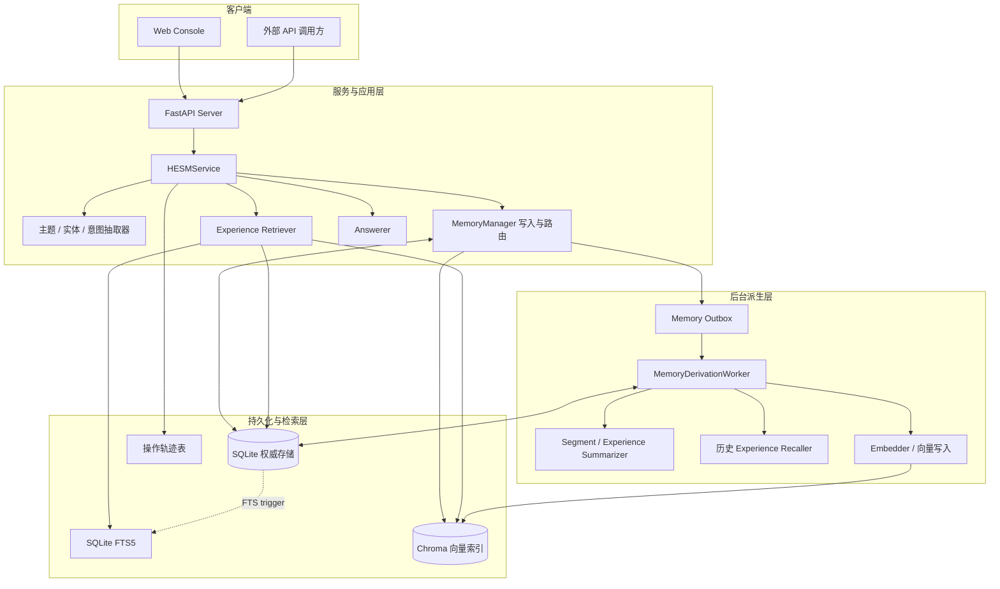
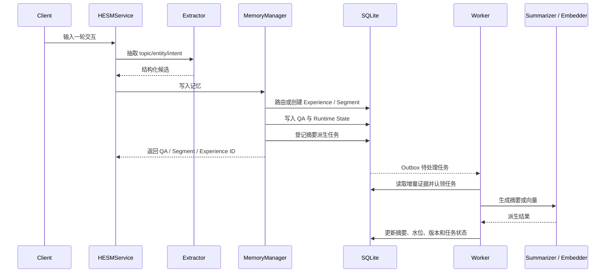
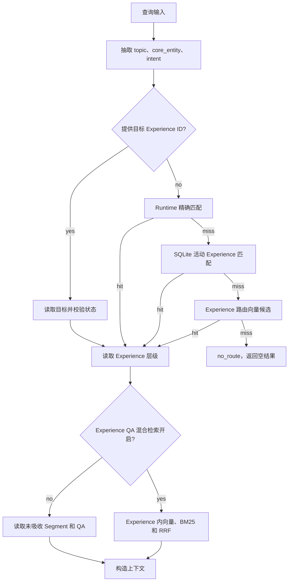

# HESM 系统设计

## 1. 系统概述

HESM（Hierarchical Experience State Memory）是面向持续任务的分层记忆系统。它将交互原文、阶段状态和长期任务状态组织为 `Experience → Segment → QA`，通过摘要降低上下文读取成本，同时保留对原始 QA 的追溯能力。

HESM 不把向量库当作唯一记忆，也不把摘要当作原始证据。SQLite 保存记忆实体、状态和父子关系；FTS5 与 Chroma 是辅助检索结构；后台派生任务负责维护摘要和向量。

## 2. 系统总架构



### 架构分层

| 层 | 组成 | 职责 |
|---|---|---|
| 客户端层 | Web Console、外部 API 调用方 | 记忆管理、检索、聊天和操作查询 |
| 服务层 | FastAPI、`HESMService` | 参数校验、组件编排、请求轨迹记录、流式响应 |
| 领域层 | 抽取器、`MemoryManager`、Retriever、Answerer | 结构化抽取、记忆路由与写入、只读检索、回答生成 |
| 权威数据层 | SQLite | 保存 QA、Segment、Experience、运行状态、派生任务和轨迹 |
| 派生检索层 | FTS5、Chroma | 文本检索、语义候选召回、路由和内容索引 |
| 后台派生层 | Outbox、Worker、Summarizer、Recaller、Embedder | 增量摘要、历史经验召回、向量索引维护和失败重试 |

## 3. 系统设计理念

### 3.1 以任务经历为主轴

系统以 Experience 表达较长周期的任务或主题实体，以 Segment 表达任务推进中的阶段，以 QA 保存该阶段发生的原始交互。父子关系由稳定 ID 维护，避免仅靠向量相似度推断归属。

### 3.2 原始证据与摘要分层

QA 是可回溯证据；Segment 和 Experience 是从下层证据形成的状态摘要。摘要降低读取成本，但必须携带版本、水位和来源 QA ID 等关联信息。摘要遗漏或过期时，系统仍能从原始记录重新构建。

### 3.3 状态是业务语义，不是检索分数

`open`、`completed`、`deleted` 描述记忆对象生命周期。向量相似度只用于生成候选；候选能否复用或返回仍由 SQLite 中的实体状态、路由阈值和父子关系决定。

### 3.4 写入可增量，派生可恢复

QA 原文优先落入 SQLite。摘要、父级向量等耗时派生操作通过 outbox 管理，任务携带目标版本并可重试。水位表示父级摘要已经吸收的子级范围，不代表旧 QA 已失效或可删除。

### 3.5 检索先确定 Experience 边界

检索先路由到已有 Experience，再读取其下 Segment 和 QA。路由失败时返回空结果；不以全库 QA 搜索绕过路由边界。可选 QA 混合检索也严格限制在已路由的 Experience 内。

### 3.6 派生索引可重建

SQLite 是业务实体和关系的权威副本。FTS5 由 QA 表触发器维护；Chroma 的向量和 metadata 是派生数据。索引不可用或不一致时，应回到 SQLite 状态核验，并通过向量派生任务重建。

### 3.7 记忆与请求轨迹分开理解

QA 保存任务交互证据；Chat、Retriever、Add、Segment Update 和 Experience Update 记录系统请求及派生操作。系统操作成功不等于用户任务成功，轨迹状态不能直接充当答案正确性标签。

## 4. 领域模型与生命周期

```text
Experience（长期主题 / 核心实体 / 任务状态）
├── Segment（阶段意图 / 阶段状态）
│   ├── QA（输入、输出、工具信息、时间和来源）
│   └── QA ...
└── Segment ...
```

- **Experience**：聚合跨阶段目标、阶段轨迹、稳定事实和当前状态；结束后可以触发历史 Experience 召回。
- **Segment**：围绕某个 intent 组织一组 QA；阶段意图切换或语义不兼容时新建阶段。
- **QA**：保存用户输入、助手输出、工具记录、抽取结果和来源标识；默认作为原始证据保留。
- **Runtime State**：保存某个 `state_key` 当前指向的 Experience 与 Segment，属于会话路由指针，不是记忆内容。

状态关系：

| 对象 | 状态 | 含义 |
|---|---|---|
| QA | `open` | 可用于正常检索的证据 |
| QA | `deleted` | 逻辑删除，不参与正常检索 |
| Segment / Experience | `open` | 当前可继续写入或更新的记忆 |
| Segment / Experience | `completed` | 阶段或任务结束，仍可按检索策略读取 |
| Segment / Experience | `deleted` | 逻辑删除，不参与正常检索 |

摘要任务依据新证据数量、子级版本及显式生命周期事件增量推进。系统不应仅凭长时间无交互推断任务完成。

## 5. 核心业务流程设计

### 5.1 写入设计



### 5.2 Experience 路由设计

写入时优先检查当前 `state_key` 的运行时 Experience 是否与 topic/core entity 匹配；否则查询 SQLite 中的活动 Experience，再用 `experience_route` 向量查候选。候选经过 SQLite 状态核验和相似度阈值判断后复用；没有合适候选时创建新 Experience。

Segment 路由在 Experience 范围内检查当前阶段及有限的近期阶段，结合 intent 与语义相似度判断复用。阶段数少不构成合并不相容意图的理由。找不到兼容 Segment 时创建新阶段。

### 5.3 增量摘要设计

QA 写入后，系统登记 Segment 更新任务。Worker 读取尚未被摘要水位覆盖的 QA；达到配置阈值或收到强制汇总信号时，调用 Segment Summarizer。Segment 发生摘要/状态变化后，登记父 Experience 更新任务。Experience Worker 汇总尚未吸收的 Segment 更新，并同步 Experience 状态、摘要水位和内容向量任务。

摘要的输入包含当前对象已有状态和新增证据，输出写回结构化 summary。失败时不推进对应水位；任务保留错误与重试次数，避免将未处理内容误认为已汇总。

### 5.4 检索设计



检索为只读过程，不创建 Experience、不改变摘要水位。默认层级读取保留 Experience 及增量 Segment/QA；启用 `experience_qa_hybrid_enabled` 时，QA 通道改为在该 Experience 内进行向量和 BM25 排序，并附带匹配诊断信息。该开关不改变 Experience 路由，也不提供路由失败后的全库回退。

### 5.5 历史经验召回

历史经验召回以已完成 Experience 为候选来源，按 topic、核心实体和查询语义召回相关经历，并由 Recaller 合并为当前 Experience 可引用的历史上下文。历史经验字段与当前任务摘要分开保存，避免旧任务事实与当前状态混淆。

## 6. 存储、检索与一致性边界

| 数据类别 | 存储位置 | 一致性职责 |
|---|---|---|
| QA、Segment、Experience、运行状态 | SQLite | 权威保存内容、状态和关系 |
| Chat/Retriever/Add/派生操作记录 | 同一 SQLite 文件中的轨迹表 | 请求审计与派生过程定位 |
| QA 全文索引 | SQLite FTS5 | 由 QA 触发器更新；用于词项候选召回 |
| QA/Segment/Experience 向量 | Chroma | 语义候选召回；写入后需按 SQLite 状态过滤 |
| 摘要与向量更新任务 | SQLite Outbox | 版本化、可恢复、可重试的派生工作 |

异步派生带来短暂滞后：SQLite 中的新 QA 可能先于 Segment/Experience 摘要和向量可见。服务和运维工具应通过 outbox 与派生轨迹判断任务是否完成，而不能仅依据原始 QA 已存在就假设父级索引已更新。

`state_key` 用于会话当前记忆指针。它不构成用户授权边界；多用户部署需在 API 授权、SQLite 查询、向量过滤和导出路径统一实现用户/租户隔离。

## 7. 关键设计参数

实现参数由 `config/hesm.yaml` 提供，主要包括：

- Experience 路由相似度阈值和歧义 margin。
- QA 混合检索开关、向量/BM25 候选上限及 RRF 常数。
- Segment QA 增量摘要阈值、Experience Segment 更新阈值。
- Segment 相似度、路由 margin 和近期候选窗口。
- Outbox worker 的轮询间隔、批次大小和最大重试次数。
- API 返回的 Segment/QA 数量上限。

阈值是检索与生命周期行为的配置，不应解释成概率或任务成功率；应结合路由与检索评估数据调整。
