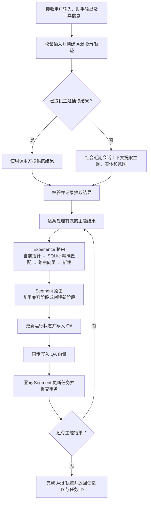
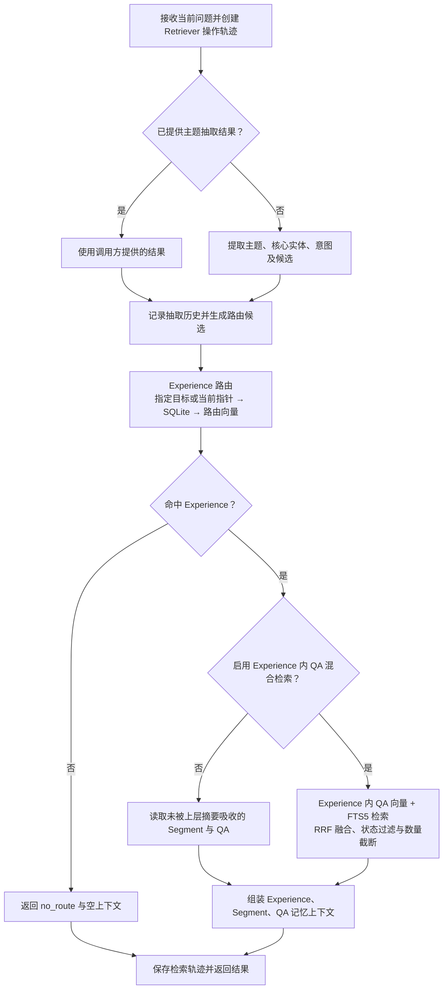

# HESM 系统实现说明

## 1. 文档范围

本文按当前代码说明 HESM 的模块结构、数据库表与字段、核心写入/摘要/检索逻辑及服务接口。系统理念和架构图见 [HESM 系统设计](HESM_SYSTEM_DESIGN_CN.md)。字段类型依据 SQLite 建表语句；JSON 字段在 SQLite 中以 `TEXT` 保存，读写时由仓储层序列化和反序列化。

## 2. 代码模块

| 模块 | 主要文件 | 实现职责 |
|---|---|---|
| 服务入口 | `service/server.py` | FastAPI 路由、请求模型、管理查询和静态前端挂载 |
| 服务编排 | `service/hesm_service.py` | 模型/存储装配，写入、检索、聊天、流式事件及轨迹关联 |
| 记忆管理 | `core/manager.py` | Experience 与 Segment 路由/创建，QA 写入，向量写入和 outbox 入队 |
| 存储仓储 | `core/storage.py` | 业务 schema、迁移、SQL CRUD、FTS5、状态检查和 outbox |
| 后台派生 | `core/worker.py` | outbox 认领、增量摘要、状态推进、历史经验召回及索引更新 |
| 摘要器 | `core/summarizer.py`、`core/prompts/` | 模板摘要和 LLM 摘要，分别维护 Segment 与 Experience 状态 |
| 检索器 | `core/retriever.py` | 只读 Experience 路由、层级读取和可选的 Experience 内 QA 混合排序 |
| 历史召回 | `core/recaller.py` | 从已完成 Experience 中召回、去重并总结历史经验 |
| 向量组件 | `core/embedder.py`、`core/vector_store.py` | 文本编码、向量文档/metadata 生成、Chroma 查询与写入 |
| 操作轨迹 | `core/trajectory.py` | Chat、Retriever、Add、Segment Update 和 Experience Update 的持久化审计记录 |
| 前端 | `frontend/` | 记忆浏览、检索调试、聊天、会话与后台操作轨迹页面 |

## 3. SQLite 数据表与字段

业务 schema 定义在 `core/storage.py`，操作轨迹 schema 定义在 `core/trajectory.py`。两者写入同一个配置数据库文件。下文先说明每张表的职责及关系，再逐表列出全部字段。JSON 列实际类型为 `TEXT`，字段名以 `_json` 结尾；仓储层负责将 Python 对象转换为 JSON 字符串。

### 表结构总览

数据库包含 12 张普通表和 1 张 FTS5 虚拟表，可按职责分为分层记忆、运行与派生、会话与主题历史、操作轨迹四组。核心记忆的父子关系是 `experience_memory` → `segment_memory` → `qa_memory`；实际归属以子表外键为准，父表中的 ID 数组用于读取和展示。

| 分组 | 表 | 功能 |
|---|---|---|
| 分层记忆 | `experience_memory` | 保存主题级长期经验、结构化摘要、历史经验召回结果及摘要进度 |
| 分层记忆 | `segment_memory` | 保存某一经验下的意图阶段、阶段摘要及已处理 QA 水位 |
| 分层记忆 | `qa_memory` | 保存原始用户输入、助手输出、工具信息及主题抽取结果 |
| 分层记忆 | `qa_fts` | 为 QA 的文本字段建立 FTS5 全文索引，供可选的混合检索使用 |
| 运行与派生 | `runtime_state` | 记录 `state_key` 当前指向的 Experience 和 Segment |
| 运行与派生 | `memory_outbox` | 持久化摘要、历史召回和向量更新等后台任务及重试状态 |
| 会话与主题历史 | `chat_session` | 保存对话会话状态及兼容消息快照 |
| 会话与主题历史 | `topic_extraction_history` | 按会话和用户保存主题抽取历史 |
| 操作轨迹 | `chat` | 记录一次完整聊天请求及其生成结果 |
| 操作轨迹 | `retriever` | 记录一次检索的输入、候选、结果和耗时 |
| 操作轨迹 | `add` | 记录一次记忆写入及其影响的记忆对象和派生任务 |
| 操作轨迹 | `segment_update` | 记录一次阶段更新的输入、前后快照、版本和执行状态 |
| 操作轨迹 | `experience_update` | 记录一次经验更新的输入、前后快照、版本和执行状态 |

`chat`、`retriever` 和 `add` 通过操作 ID 关联同一轮处理；`segment_update`、`experience_update` 可继续关联 `add` 与 `memory_outbox`，用于回溯后台更新。`qa_fts` 是检索索引，不是另一份独立的业务记忆。

### 3.1 `experience_memory`：Experience 主表

| 字段 | SQLite 类型 | 用途 |
|---|---|---|
| `experience_id` | TEXT PK | Experience 稳定主键 |
| `history_experience_json` | TEXT | 从历史 Experience 召回并附加到当前 Experience 的历史经验 |
| `topic` | TEXT | Experience 主题 |
| `core_entity` | TEXT | Experience 核心实体 |
| `intents_link_json` | TEXT | 该 Experience 涉及的 intent 列表 |
| `segment_ids_json` | TEXT | 所属 Segment ID 列表（便于读取/快照；关系仍以子表为准） |
| `summary_json` | TEXT | Experience 级结构化摘要 |
| `created_at` | TEXT | 创建时间 |
| `updated_at` | TEXT | 最近一次业务或派生更新的时间 |
| `version` | INTEGER | 当前记录版本 |
| `last_summarized_segment_count` | INTEGER | 最近一次 Experience 摘要覆盖的 Segment 数量 |
| `last_summarized_child_revision` | INTEGER | 最近摘要覆盖的子 Segment 汇总 revision |
| `last_updated_segment_id` | TEXT | 最近被 Experience 摘要吸收的 Segment 标记 |
| `last_updated_segment_at` | TEXT | 上述 Segment 的更新时间标记 |
| `status` | TEXT | `open`、`completed` 或 `deleted` |

### 3.2 `segment_memory`：阶段主表

| 字段 | SQLite 类型 | 用途 |
|---|---|---|
| `segment_id` | TEXT PK | Segment 稳定主键 |
| `topic` | TEXT | 所属阶段的主题 |
| `intent` | TEXT | 阶段意图，是阶段路由的重要字段 |
| `core_entity` | TEXT | 阶段核心实体 |
| `qa_ids_json` | TEXT | 所属 QA ID 列表（读取快照/兼容字段） |
| `summary_json` | TEXT | Segment 级结构化状态摘要 |
| `experience_id` | TEXT FK | 所属 Experience |
| `created_at` | TEXT | 创建时间 |
| `updated_at` | TEXT | 最近一次更新/派生时间 |
| `version` | INTEGER | 记录版本，用于并发和派生任务目标版本 |
| `last_summarized_qa_count` | INTEGER | 最近一次摘要吸收的 QA 数量水位 |
| `summarized_qa_ids_json` | TEXT | 最近摘要已吸收的 QA ID 集合/边界辅助信息 |
| `last_updated_qa_id` | TEXT | 最近被摘要吸收的 QA 标记 |
| `summary_version` | INTEGER | Segment 摘要派生版本，供 Experience 子级 revision 计算 |
| `status` | TEXT | `open`、`completed` 或 `deleted` |

### 3.3 `qa_memory`：原始交互证据表

| 字段 | SQLite 类型 | 用途 |
|---|---|---|
| `qa_id` | TEXT PK | QA 稳定主键 |
| `source_id` | TEXT | 上游系统提供的来源 ID，可空 |
| `timestamp` | TEXT | 交互发生时间 |
| `user_input` | TEXT | 用户原始输入 |
| `assistant_output` | TEXT | 助手输出 |
| `tools_json` | TEXT | 工具调用或工具结果列表 |
| `topic` | TEXT | 抽取出的主题 |
| `intent` | TEXT | 抽取出的意图 |
| `core_entity` | TEXT | 抽取出的核心实体 |
| `entities_json` | TEXT | 抽取出的实体列表 |
| `segment_id` | TEXT FK | 所属 Segment |
| `status` | TEXT | `open` 或 `deleted` |
| `confidence` | REAL | 主题/记忆抽取置信字段，不是任务成功率 |
| `reason` | TEXT | 抽取器提供的判断理由 |

### 3.4 `runtime_state`：会话当前指针表

| 字段 | SQLite 类型 | 用途 |
|---|---|---|
| `state_key` | TEXT PK | 会话/运行上下文键 |
| `current_experience_id` | TEXT | 当前 Experience 指针 |
| `current_segment_id` | TEXT | 当前 Segment 指针；可为空字符串 |
| `updated_at` | TEXT | 指针最近更新时间 |
| `retrieval_cache_json` | TEXT | 兼容或运行期检索缓存字段 |

该表只表达运行时路由状态；`state_key` 不承担用户授权或租户隔离。

### 3.5 `memory_outbox`：后台派生任务表

| 字段 | SQLite 类型 | 用途 |
|---|---|---|
| `job_id` | TEXT PK | 任务 ID |
| `job_type` | TEXT | 派生类型，如 Segment/Experience 更新或向量写入 |
| `memory_type` | TEXT | 目标对象类型，如 `segment`、`experience` |
| `memory_id` | TEXT | 目标对象 ID |
| `target_version` | INTEGER | 该任务应处理到的目标版本/revision |
| `status` | TEXT | `pending`、`processing`、`completed` 或 `failed` |
| `retry_count` | INTEGER | 已重试次数 |
| `last_error` | TEXT | 最近一次失败原因 |
| `payload_json` | TEXT | 任务参数及 Chat/Add 轨迹关联 ID |
| `created_at` | TEXT | 入队时间 |
| `updated_at` | TEXT | 最近一次状态更新时间 |

`(job_type, memory_type, memory_id)` 有唯一约束；重复入队会合并/提高目标版本，避免同一目标无限累积重复任务。

### 3.6 `chat_session`：会话列表与兼容消息表

| 字段 | SQLite 类型 | 用途 |
|---|---|---|
| `session_id` | TEXT PK | 会话 ID |
| `status` | TEXT | 会话状态，默认 `active` |
| `create_at` | TEXT | 会话创建时间 |
| `update_at` | TEXT | 会话最近更新时间 |
| `chats` | TEXT | JSON 数组，存放会话消息快照 |

### 3.7 `topic_extraction_history`：主题抽取历史表

| 字段 | SQLite 类型 | 用途 |
|---|---|---|
| `session_id` | TEXT | 会话范围键 |
| `user_id` | TEXT | 用户标识 |
| `history_json` | TEXT | 抽取历史 JSON 数组，含输入、抽取候选、来源和耗时等 |
| `created_at` | TEXT | 首次写入时间 |
| `updated_at` | TEXT | 最近更新时间 |

主键为 `(session_id, user_id)`。

### 3.8 `qa_fts`：QA 全文检索虚拟表

| 字段 | FTS5 配置 | 用途 |
|---|---|---|
| `qa_id` | `UNINDEXED` | 关联原始 QA，不参与全文分词 |
| `segment_id` | `UNINDEXED` | 关联阶段，不参与全文分词 |
| `user_input` | 全文索引 | 用户输入词项 |
| `assistant_output` | 全文索引 | 助手输出词项 |
| `topic` | 全文索引 | 主题词项 |
| `intent` | 全文索引 | 意图词项 |
| `core_entity` | 全文索引 | 核心实体词项 |
| `entities` | 全文索引 | 实体词项 |

使用 `unicode61 remove_diacritics 2` tokenizer。插入、更新和删除同步触发器维护 FTS 内容；检索结果仍需回查 QA 与父级状态。

### 3.9 `chat`：一次聊天请求表

| 字段 | SQLite 类型 | 用途 |
|---|---|---|
| `chat_id` | TEXT PK | Chat 请求 ID |
| `session_id` | TEXT FK | 所属会话 |
| `retriever_id` | TEXT UNIQUE/FK | 关联的 Retriever 操作 |
| `add_id` | TEXT UNIQUE/FK | 关联的 Add 操作 |
| `user_input` | TEXT | 本轮用户输入 |
| `assistant_output` | TEXT | 本轮助手输出 |
| `status` | TEXT | `running`、`completed`、`failed` 或 `interrupted` |
| `created_at` | TEXT | 请求创建时间 |
| `updated_at` | TEXT | 最近更新时间 |
| `elapsed_ms` | REAL | 请求耗时 |
| `model` | TEXT | 回答模型标识 |
| `error_message` | TEXT | 失败信息 |
| `metadata_json` | TEXT | 请求元数据 |
| `prompt_text` | TEXT | 最终回答所用提示文本 |
| `timing_json` | TEXT | 抽取、检索、生成等阶段耗时 |

### 3.10 `retriever`：一次检索操作表

| 字段 | SQLite 类型 | 用途 |
|---|---|---|
| `retriever_id` | TEXT PK | 检索操作 ID |
| `chat_id` | TEXT FK | 关联 Chat；独立检索时可空 |
| `question` | TEXT | 原始查询文本 |
| `topic_extract_json` | TEXT | 主抽取结果 |
| `query_candidates_json` | TEXT | 抽取器给出的候选路由列表 |
| `experiences_json` | TEXT | 本次返回的 Experience 快照 |
| `segments_json` | TEXT | 本次返回的 Segment 快照 |
| `qas_json` | TEXT | 本次返回的 QA 快照 |
| `context_text` | TEXT | 实际组装的检索上下文 |
| `topic_extract_time_ms` | REAL | 抽取耗时 |
| `retrieval_time_ms` | REAL | 核心检索耗时 |
| `elapsed_ms` | REAL | 操作总耗时 |
| `status` | TEXT | `pending`、`running`、`completed` 或 `failed` |
| `created_at` | TEXT | 创建时间 |
| `updated_at` | TEXT | 更新时间 |
| `error_message` | TEXT | 失败信息 |

### 3.11 `add`：一次记忆写入操作表

| 字段 | SQLite 类型 | 用途 |
|---|---|---|
| `add_id` | TEXT PK | 写入操作 ID |
| `chat_id` | TEXT FK | 关联 Chat；独立写入时可空 |
| `topic_extract_json` | TEXT | 写入时的抽取结果 |
| `experience_id` | TEXT | 主 Experience ID |
| `segment_id` | TEXT | 主 Segment ID |
| `experience_ids_json` | TEXT | 本次影响的 Experience ID 列表 |
| `segment_ids_json` | TEXT | 本次影响的 Segment ID 列表 |
| `qa_ids_json` | TEXT | 本次创建的 QA ID 列表 |
| `memory_outbox_id` | TEXT FK | 主要派生任务 ID |
| `memory_outbox_ids_json` | TEXT | 所有关联派生任务 ID |
| `user_input` | TEXT | 写入的用户输入 |
| `assistant_output` | TEXT | 写入的助手输出 |
| `action` | TEXT | 写入动作类型，如追加或新建阶段 |
| `status` | TEXT | `pending`、`completed` 或 `failed` |
| `created_at` | TEXT | 创建时间 |
| `updated_at` | TEXT | 更新时间 |
| `elapsed_ms` | REAL | 写入耗时 |
| `error_message` | TEXT | 失败信息 |

### 3.12 `segment_update`：Segment 派生操作轨迹表

| 字段 | SQLite 类型 | 用途 |
|---|---|---|
| `segment_update_id` | TEXT PK | Segment 派生操作 ID |
| `add_id` | TEXT FK | 触发该更新的 Add 操作 |
| `memory_outbox_id` | TEXT FK | 对应的 outbox 任务 |
| `segment_id` | TEXT FK | 被更新的 Segment |
| `old_segment_json` | TEXT | 更新前快照 |
| `distill_input_json` | TEXT | 实际参与摘要的证据输入 |
| `prompt_text` | TEXT | 摘要提示文本 |
| `output_text` | TEXT | 模型原始输出 |
| `new_segment_json` | TEXT | 更新后快照 |
| `before_version` | INTEGER | 更新前版本 |
| `after_version` | INTEGER | 更新后版本 |
| `status` | TEXT | `running`、`completed`、`skipped` 或 `failed` |
| `skip_reason` | TEXT | 跳过原因，如未达到摘要阈值 |
| `model` | TEXT | 摘要模型标识 |
| `started_at` | TEXT | 开始时间 |
| `finished_at` | TEXT | 结束时间，可空 |
| `elapsed_ms` | REAL | 耗时 |
| `error_message` | TEXT | 失败信息 |
| `created_at` | TEXT | 记录创建时间 |

### 3.13 `experience_update`：Experience 派生操作轨迹表

| 字段 | SQLite 类型 | 用途 |
|---|---|---|
| `experience_update_id` | TEXT PK | Experience 派生操作 ID |
| `add_id` | TEXT FK | 触发该更新的 Add 操作 |
| `memory_outbox_id` | TEXT FK | 对应的 outbox 任务 |
| `segment_update_id` | TEXT FK | 可选的上游 Segment 更新操作 |
| `experience_id` | TEXT FK | 被更新的 Experience |
| `old_experience_json` | TEXT | 更新前快照 |
| `distill_input_json` | TEXT | 实际参与汇总的 Segment 输入 |
| `prompt_text` | TEXT | 摘要提示文本 |
| `output_text` | TEXT | 模型原始输出 |
| `new_experience_json` | TEXT | 更新后快照 |
| `before_version` | INTEGER | 更新前版本 |
| `after_version` | INTEGER | 更新后版本 |
| `status` | TEXT | `running`、`completed`、`skipped` 或 `failed` |
| `skip_reason` | TEXT | 跳过原因 |
| `model` | TEXT | 摘要模型标识 |
| `started_at` | TEXT | 开始时间 |
| `finished_at` | TEXT | 结束时间，可空 |
| `elapsed_ms` | REAL | 耗时 |
| `error_message` | TEXT | 失败信息 |
| `created_at` | TEXT | 记录创建时间 |

## 4. 写入、检索与记忆更新逻辑

### 4.1 记忆写入：`HESMService.add_memory` → `MemoryManager.add_qa`



1. 服务层校验非空用户输入，创建 `add` 操作轨迹；若调用方没有提供 `topic_result`，主题抽取器从用户输入和近期会话上下文提取一个或多个候选。抽取历史写入 `topic_extraction_history`。
2. 对每个抽取结果，管理器要求 `topic`、`core_entity` 和 `intent` 非空，同时读取实体、置信字段和判断理由。一个输入有多个有效抽取结果时，可分别生成记忆记录。
3. Experience 写入路由先检查 `runtime_state` 当前指针；若当前经验不可复用，依次查找 SQLite 中主题和核心实体精确匹配的活动经验、`experience_route` 向量候选，仍无结果才新建 Experience。离开旧阶段时，登记其收口与强制总结任务。
4. Experience 确定后，在近期阶段窗口中按意图和语义一致性查找可复用 Segment；不合适时新建 Segment，并为需要收口的旧阶段登记更新任务。随后更新 `runtime_state`。
5. 创建 QA，保存原始输入、助手输出、工具信息及主题抽取字段；QA 写入 SQLite 后同步生成 QA 向量，并登记 Segment 更新 outbox 任务，最后提交数据库事务。异常时回滚 SQLite 写入。
6. 服务层完成 `add` 轨迹，记录新建的 QA、涉及的 Segment/Experience 和 outbox 任务 ID，并返回本次写入结果。新建 Experience 时还会登记历史经验召回与路由向量创建任务。

`experience_route` 向量主要表示主题和核心实体，用于经验路由；Experience 内容向量反映摘要等内容，用于内容检索。两类向量用途不同。

### 4.2 记忆检索：`HESMService.retrieve` → `HybridRetriever.retriever`



1. 服务层校验问题文本，创建 `retriever` 操作轨迹。默认由主题抽取器获得查询的主题、核心实体、意图与候选；也可接收调用方提供的 `topic_result`。抽取结果写入主题历史。
2. 检索器先确定目标 Experience。如指定 `target_experience_id`，直接读取该经验并排除 `deleted`；否则按 `runtime_state` 当前经验、SQLite 活动经验精确匹配、`experience_route` 向量候选的顺序路由。向量候选必须仍为活动经验且超过相似度阈值；接近的候选交由目标选择逻辑处理。
3. 若没有命中 Experience，返回 `route_status=no_route` 和空的经验、阶段、QA 与上下文；当前实现不再扩大到全库 QA 检索。
4. 命中后，默认读取该 Experience 中尚未被上层摘要吸收的 Segment，再读取这些 Segment 中尚未被阶段摘要吸收的 QA；结果按时间与 ID 稳定排序，并结合 Experience 摘要构造上下文。历史经验字段与当前摘要分开保存和呈现。
5. 可选的 `experience_qa_hybrid_enabled` 模式在已路由的 Experience 内，对 QA 向量候选和 FTS5 BM25 候选做 RRF 融合排序；结果回查 SQLite，过滤已删除和跨 Experience 的记录，再按数量上限返回。该模式只改变经验内部的 QA 排序，不改变 Experience 路由。
6. 服务层保存路由来源、候选、结果快照、上下文和耗时。`chat`/`chat_events` 在检索后继续生成回答，并将完整交互交给写入流程。

### 4.3 记忆更新：`MemoryDerivationWorker`

写入 QA 与更新上层摘要分为两个阶段。QA 及其向量在写入请求中同步产生；Segment/Experience 的摘要、历史经验召回与相关向量更新由 `memory_outbox` 驱动。Worker 批量认领任务，处理前记录对象快照和输入，完成后更新任务状态及操作轨迹。

1. **阶段更新**：`update_segment` 读取阶段下的 QA 和尚未纳入摘要的增量。增量达到 `segment_qa_threshold`，或任务要求强制总结时，调用 Segment Summarizer；随后协调 `qa_ids_json`、阶段状态、摘要、已总结 QA 数量及 `summary_version`。首次加入 QA、摘要变化或状态变化时，登记阶段向量任务；若影响父经验，同时登记 Experience 更新任务。
2. **经验更新**：`update_experience` 读取该经验下的 Segment，以子阶段 `summary_version` 累计值计算尚未吸收的修订量。达到 `experience_segment_threshold` 时调用 Experience Summarizer，更新经验摘要、阶段数量水位、子级修订水位及最近处理阶段标记。摘要、阶段关系或状态发生变化时，登记 Experience 内容向量更新任务。
3. **历史经验召回**：新建 Experience 时登记 `recall_experience_history`。`ExperienceRecaller` 从已完成的历史 Experience 中通过关系和向量检索找候选，去重并组织结果，由 Worker 写入 `history_experience_json`；该字段与当前经验摘要分开维护。
4. **索引维护**：`embed_segment` 和 `embed_experience` 更新内容向量；`create_experience_route_vector` 为新经验建立路由向量。旧的 `embed_experience_route` 任务类型仅作兼容处理，不用于常规刷新。
5. **失败与跳过**：派生异常会回滚本次数据库变更，记录 outbox 的错误和重试次数，并将对应更新轨迹标记为失败。未达到摘要阈值时仍可协调关系或状态；摘要轨迹记录为 `skipped` 及原因，不表示模型已生成新摘要。

### 4.4 服务编排

`HESMService` 装配抽取器、存储、向量库、MemoryManager、Retriever、Answerer、轨迹仓储和可选后台 Worker。外部 Agent 可分别调用 `retrieve` 和 `add_memory`，保留自己的回答流程；`chat`/`chat_events` 则由 HESM 编排检索、回答和写入。

## 5. 向量类型与索引

向量文档和 metadata 在 `core/vector_store.py` 构造，主要 memory type 如下：

| 类型 | 用途 | 典型 metadata |
|---|---|---|
| `experience_route` | Experience 身份/任务路由候选 | Experience ID、topic、core entity、状态相关信息 |
| `experience` | Experience 摘要内容检索 | Experience ID、主题、实体、状态、更新时间 |
| `segment` | 阶段摘要与近期问题检索 | Segment ID、Experience ID、intent、主题/实体 |
| `qa` | 问答语义检索 | QA ID、Segment ID、Experience ID、主题/实体/意图 |

向量查询结果不是最终授权或状态判断。检索器或调用方应使用 SQLite 中的主记录核验状态和 Experience 归属。

## 6. HTTP API 与前端

服务路由位于 `service/server.py`，核心接口：

| 方法/路径 | 功能 |
|---|---|
| `GET /api/health`、`GET /api/stats` | 健康状态、数量统计 |
| `GET/POST /api/sessions`、`GET /api/sessions/{session_id}` | 会话列表、创建和详情 |
| `GET /api/sessions/{session_id}/topic-extractions` | 会话主题抽取记录 |
| `GET /api/chats/{chat_id}/trajectory` | Chat 及其 Retriever/Add/派生操作轨迹 |
| `GET /api/operations`、`GET /api/operations/{operation_type}/{operation_id}` | 后台和请求操作列表/详情 |
| `GET /api/{level}`、`GET /api/{level}/{memory_id}` | Experience、Segment、QA 列表/详情 |
| `PATCH /api/{level}/{memory_id}/status` | 更新允许的记忆状态 |
| `POST /api/memories` | 写入记忆 |
| `POST /api/retrieve` | 只读检索 |
| `POST /api/chat`、`POST /api/chat/stream` | 普通聊天与流式聊天 |

`frontend/` 提供记忆管理、检索、聊天和操作轨迹界面。FastAPI 启动时挂载静态页面。

## 7. 配置与运行

配置文件为 `config/hesm.yaml`，涵盖数据库/Chroma 路径、默认 user ID、模型连接、Experience 路由阈值、QA 混合检索参数、摘要阈值、worker 参数及 API 返回上限。凭据不应复制到文档或提交到公开版本库；部署应使用安全配置注入。

项目根目录启动：

```powershell
python -m service.server
```

## 8. 实现边界

- `state_key` 是运行时指针键，不是数据访问控制策略；多用户部署必须按授权范围约束 SQLite、向量检索和导出。
- `chat`、`add`、outbox 的 `completed` 只表示系统处理阶段完成，不代表用户任务成功或答案正确。
- Outbox 派生存在时间差；QA 先写入、摘要和父级向量稍后可见是当前异步设计的正常现象。
- Route miss 返回空结果是当前预期行为；混合 QA 检索不会跨 Experience 回退。
- SQLite 是内容、关系和状态的权威来源；Chroma/FTS 索引问题应通过主记录和派生任务轨迹诊断。
