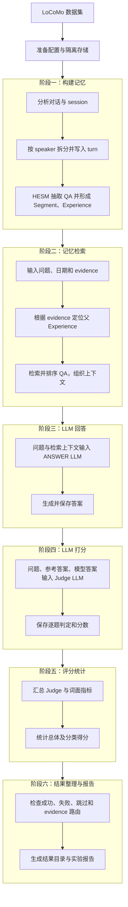

# HESM LoCoMo `evidence_topic_retrieval` 实验流程

本文按“构建记忆 → 检索记忆 → LLM 回答 → LLM 打分 → 统计指标 → 生成报告”的实验顺序说明各阶段做什么、输入什么、产出什么。推荐使用 v2 隔离配置；运行时数据按数据集与版本隔离。

## 1. 实验目的与边界

LoCoMo 每道问题带有标注的 `evidence`（例如 `D1:3`）。普通 HESM 在查询时由 LLM 提取主题/实体；本消融实验改为先从本次运行的 HESM QA 找到 evidence 对应的父 Experience，读取该 Experience 的 `topic/core_entity`，并将 Experience ID 作为路由目标，再在该 Experience 内检索 QA。QA 排序使用向量检索和 SQLite FTS5 BM25，并以 RRF 融合。

这是带 oracle evidence 的检索消融；evidence 只作为路由监督信号，不应描述成不依赖 gold 标注的普通部署检索。LoCoMo category 5 不参加常规评测（以 OmniMemEval 脚本定义为准）。回答生成、Judge 和指标由 OmniMemEval 执行，HESM 负责记忆写入与检索。

## 2. 当前推荐配置

- 配置：`experiments/config/evidence_topic_retrieval_v2.yaml`
- 模式：`experiment.retrieval_topic_source: evidence_topic_lookup`
- 存储：`experiments/.runtime/evidence_topic_retrieval_v2/<dataset_id>/`
- 结果：`D:\code\OmniMemEval\results\locomo\hesm-<version>_locomo\`
- 默认 LoCoMo 文件：`D:\code\OmniMemEval\data\locomo\locomo10.json`
- API 参数：HESM `top_qa: 5`；启动器 `--top-k 20` 是评测客户端请求参数，不等于 HESM 最终 QA 数量。

每次独立实验使用新的 `--version`。启动器将版本、benchmark 和数据 SHA256 前缀组成 `dataset_id`，避免复用其他数据集/版本的用户库。每位 speaker/user 有各自 SHA256 目录，内含 `hesm.sqlite3` 与 Chroma；请求汇总在数据集级 `requests.sqlite3`。

## 3. 运行前检查

1. 确认 `D:\code\OmniMemEval\data\locomo\locomo10.json` 存在，且 HESM 与 OmniMemEval 源码为预期版本。启动器会在 manifest 保存数据哈希和六个阶段脚本的源文件哈希。
2. 在 `experiments/.env.user_memory` 配置独立实验凭据。至少包括 HESM bearer token、主题抽取/摘要模型、embedding 模型、OmniMemEval answer/judge 模型。不要把凭据写进报告或提交到仓库。
3. 执行模型与配置预检：

   ```powershell
   python -B -m experiments.preflight `
     --config experiments/config/evidence_topic_retrieval_v2.yaml `
     --env experiments/.env.user_memory --live
   ```

   `--live` 会实际请求模型和 embedding 服务。可先去掉 `--live` 只检查配置。
4. 先运行 dry-run，确认数据文件、版本、模型、参数和命令：

   ```powershell
   python -B -m experiments.run_user_memory `
     --benchmark locomo `
     --config experiments/config/evidence_topic_retrieval_v2.yaml `
     --env experiments/.env.user_memory `
     --version evidence_topic_lookup_v2 `
     --omnimemeval D:\code\OmniMemEval `
     --workers 1 --llm-workers 2 --top-k 20 --judge-runs 1 --dry-run
   ```

## 4. 六阶段正式运行

移除 `--dry-run` 后执行相同命令：

```powershell
python -B -m experiments.run_user_memory `
  --benchmark locomo --version evidence_topic_parent_hybrid_smoke_v1 --smoke `
  --config experiments/config/evidence_topic_retrieval_v2.yaml `
  --env experiments/.env.user_memory `
  --data D:\code\hesm\experiments\.runtime\smoke_data\locomo.json `
  --omnimemeval D:\code\OmniMemEval `
  --eval-python C:\ProgramData\anaconda3\envs\omnimemeval\python.exe `
  --service-python C:\ProgramData\anaconda3\python.exe `
  --workers 1 --llm-workers 1 --top-k 5 --direct-network
```

启动器自动启动临时 HESM evaluation service，按顺序运行以下六个阶段。前四步中的前两步是记忆系统实验的核心：先用 LoCoMo 对话构建每位 speaker 的记忆，再用问题检索相关记忆；回答与打分阶段消费检索结果，不重新构建记忆。



### 阶段 1：构建记忆（Ingestion）

**做什么：**读取 LoCoMo 的对话记录，按 conversation/session 拆分消息，分别写入对话双方各自的 HESM 用户存储。每个 turn 附带稳定的 evidence key（如 `D1:3`），并保留时间信息。HESM 对消息调用原生记忆写入：抽取 topic/entity，保存 QA，再由异步记忆管理任务归纳 Segment 和 Experience。

**输入：**LoCoMo 对话、speaker 信息、session 时间与 turn evidence key。

**输出：**每个 speaker 独立的 HESM SQLite/Chroma 存储；QA 与来源 evidence 关联，并形成 QA → Segment → Experience 层级。检索开始前，服务会等待异步派生任务完成，确保使用完整记忆快照。

### 阶段 2：记忆检索（Search）

**做什么：**对每个评测问题向两位 speaker 的记忆分别发起查询，传入问题、问题日期和标注 evidence。实验使用 evidence 的首个 key 找到对应 QA 及其父 Experience，读取写入阶段已形成的 topic/core_entity，并携带 Experience ID 定向路由；随后在该 Experience 内进行 QA 向量召回和 FTS5 BM25 检索，以 RRF 融合并整理为上下文。若 evidence 或映射缺失，当前实现会记录并回退原生 LLM 主题抽取。

**输入：**LoCoMo 问题、问题日期、evidence key，以及阶段 1 构建好的两份 speaker 记忆。

**输出：**每题的检索上下文、候选 QA/Experience、路由轨迹和 topic 提取来源。`topic_extraction_source=evidence_topic_lookup` 表示命中 evidence 查找；`llm` 表示回退，需单独统计。

### 阶段 3：LLM 回答（Responses）

**做什么：**将每道问题和阶段 2 返回的检索上下文交给 OmniMemEval 配置的 ANSWER 模型，生成最终回答。运行配置保存模型输入，便于复查模型实际看到了哪些记忆。

**输入：**问题、检索上下文及回答提示词。

**输出：**逐题模型答案和对应的输入/运行记录。配置为检索或回答失败时不跳过，以便暴露数据与服务问题。

### 阶段 4：LLM 打分（Eval）

**做什么：**把问题、参考答案和模型答案提交给 EVAL/Judge 模型，判断答案是否正确。`--judge-runs` 控制每道题重复评判次数；推荐先用 1 次，若做稳定性分析再另设版本重复运行。

**输入：**LoCoMo 问题、gold answer、阶段 3 的模型答案。

**输出：**逐题 Judge 判定与评分结果。Judge 失败不跳过；失败项应修复后续跑，不应静默丢弃。

### 阶段 5：评分统计（Metric）

**做什么：**汇总逐题评分，计算主指标 LLM-as-Judge accuracy，并计算 OmniMemEval 定义的词面指标，如 F1、ROUGE、BLEU、METEOR。类别统计可用于分析不同问题类型的差异。

**输入：**阶段 3 的生成答案、阶段 4 的逐题 Judge 结果和数据集参考答案。

**输出：**总体分数、类别分数和指标文件。报告分数时同时给出有效题数与失败/跳过数，避免分母不一致造成误读。

### 阶段 6：生成实验报告（Report）

**做什么：**整理实验配置、运行状态、指标、资源/上下文信息和结果路径，形成便于复现与比较的报告。完成后再核对 manifest 是否为 `complete`，并审计 evidence 命中/回退及目标 Experience 路由。

**输入：**manifest、阶段日志、搜索/回答/Judge 结果、评分统计和 HESM 路由轨迹。

**输出：**`exp_report.md` 等报告文件，以及可追溯到配置、数据和源码哈希的结果目录。

### 流程图对应关系

流程图中的阶段 1 对应“构建记忆”：原始对话经过解析和写入，形成 HESM 分层记忆；阶段 2 对应“记忆检索”：问题和 evidence 从这些记忆中取回上下文；阶段 3 和 4 分别是回答模型生成答案、Judge 模型评判答案；阶段 5 汇总分数，阶段 6 整理实验产物并进行完整性审计。每阶段输出会成为下一阶段输入，因此要先确认 ingestion 完成，再开始完整评测。

启动器按阶段调用以下 OmniMemEval 脚本：

| 阶段 | 脚本 | 主要输入 → 输出 |
|---|---|---|
| 1 构建记忆 | `locomo_ingestion.py` | 对话/session → 两位 speaker 的 HESM 分层记忆及 evidence 关联 |
| 2 记忆检索 | `locomo_search.py` | 问题、日期、evidence、HESM 记忆 → 检索上下文与路由轨迹 |
| 3 LLM 回答 | `locomo_responses.py` | 问题与上下文 → ANSWER 模型答案 |
| 4 LLM 打分 | `locomo_eval.py` | 问题、参考答案、模型答案 → Judge 逐题评分 |
| 5 评分统计 | `locomo_metric.py` | Judge 结果和参考答案 → 总体/分类指标 |
| 6 生成报告 | `locomo_report.py` | 配置、日志、逐题结果、指标 → `exp_report.md` 等产物 |

各阶段日志写入 OmniMemEval 结果目录的 `hesm_step_<n>.log`；服务日志为 `hesm_service.log`。进度与可复现信息分别记录在 `hesm_execution.json` 和 `hesm_manifest.json`。失败时先查看对应阶段日志；可用 `--from-step N --to-step N` 续跑，但应保持相同版本、配置、数据和模型。若更改实验条件，必须使用新版本名。

